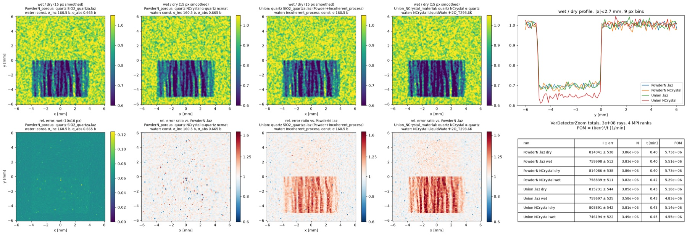

# PSI ICON imaging beamline models

McStas models of the ICON imaging instrument at PSI, CH, based on an earlier
model by Ludovic Giller. Beamline and camera are written once and `%include`d
by every model, so each model file holds only its sample.

## Models

| Folder / instrument | Sample | Purpose |
|---|---|---|
| [PSI_ICON](PSI_ICON/PSI_ICON.instr) | none | Open beam |
| [PSI_ICON_foils](PSI_ICON_foils/PSI_ICON_foils.instr) | Al and Zr foils | Propagation-based phase contrast (Paganin) beamtime model, Naver et al. |
| [PSI_ICON_porous](PSI_ICON_porous/PSI_ICON_porous.instr) | porous quartz cylinder, water in the pores (PowderN_porous) | Imaging of water uptake in a porous material |
| [PSI_ICON_porous_Union](PSI_ICON_porous_Union/PSI_ICON_porous_Union.instr) | same sample, Union components | Union reference for PSI_ICON_porous, multiple scattering |
| [PSI_ICON_porous_Union_NCrystal](PSI_ICON_porous_Union_NCrystal/PSI_ICON_porous_Union_NCrystal.instr) | same sample, Union + NCrystal quartz and water | Full NCrystal physics, incl. wavelength-dependent water cross section |

Building blocks, not meant to be run on their own for imaging:

| Folder / instrument | Content |
|---|---|
| [PSI_ICON_beamline](PSI_ICON_beamline/PSI_ICON_beamline.instr) | Source to sample goniometer. Runs standalone for beam-profile checks (`all_mons=1`) |
| [PSI_ICON_camera](PSI_ICON_camera/PSI_ICON_camera.instr) | Camera (2037x2037 px, zoom 900x900 px, 1D), 7.5 m from the entrance aperture |

## Building your own sample model

```
DEFINE INSTRUMENT My_ICON_sample(...)
...
TRACE
%include "PSI/PSI_ICON/PSI_ICON_beamline/PSI_ICON_beamline.instr"

COMPONENT Sample = ...
AT (0,0,0) RELATIVE Goniometer

%include "PSI/PSI_ICON/PSI_ICON_camera/PSI_ICON_camera.instr"
END
```

All beamline parameters (`Lambda_Min`, `Lambda_Max`, goniometer `tx`...`rz`,
`all_mons`, ...) become parameters of the including instrument; redeclaring one
in your `DEFINE INSTRUMENT` overrides its default (as PSI_ICON_foils does for
`ty`). The include paths are relative to the McStas `examples` folder, so they
resolve from any working directory.

## Porous sample variants

Quartz cylinder (radius 4 mm, height 10 mm) with pore channels along y from
`pores.off` in the McStas data folder, made with
`Tests_samples/Test_PowderN_porous/make_pores.py`:

```
python make_pores.py --radius 0.004 --yheight 0.01 --diameter 3e-4 --diameter_sigma 5e-5 --length 1.5e-3 --length_sigma 5e-4 --tilt 15 --seed 1
```

`water=1` fills the pores below `fill_y` (default 0, the sample centre), above
that they are void; `water=0` gives the dry reference.

| Variant | Quartz | Water |
|---|---|---|
| PSI_ICON_porous | `SiO2_quartza.laz` (PowderN) | constant σ_inc 160.5 b, σ_abs 0.665 b per H2O |
| PSI_ICON_porous `matrix=stdlib::SiO2-alpha_sg154_AlphaQuartz.ncmat` | NCrystal α-quartz via PowderN (Bragg, incoherent, absorption) | as above |
| PSI_ICON_porous_Union | `SiO2_quartza.laz` (Powder_process + Incoherent_process) | Incoherent_process, constant σ as above |
| PSI_ICON_porous_Union_NCrystal | `Union_NCrystal_material`, α-quartz | `Union_NCrystal_material`, `LiquidWaterH2O_T293.6K` |

PSI_ICON_porous is single scattering with forced transmission (every ray reaches
the camera with reduced weight); the Union variants are analog with multiple
scattering.

### Comparison



3e8 rays, 4 MPI ranks, `VarDetectorZoom` totals, wet/dry = `water=1` / `water=0`:

| Variant | dry | wet | wet/dry | t wet [min] | FOM wet |
|---|---|---|---|---|---|
| PowderN .laz | 814041 ± 538 | 759998 ± 512 | 0.9336 | 0.40 | 5.51e6 |
| PowderN NCrystal quartz | 814086 ± 538 | 758839 ± 511 | 0.9321 | 0.42 | 5.29e6 |
| Union .laz | 815231 ± 544 | 759697 ± 525 | 0.9319 | 0.43 | 4.83e6 |
| Union NCrystal | 808891 ± 542 | 746194 ± 522 | 0.9225 | 0.45 | 4.55e6 |

FOM = (I/err)²/t [1/min].

- The three constant-σ water variants agree: behind the water-filled pores the
  wet/dry ratio is ≈0.70. NCrystal water attenuates more over the 4.1-10 Å band,
  ≈0.65.
- The quartz description barely matters with PowderN (.laz vs NCrystal within
  1.6σ). Union NCrystal quartz transmits 0.7 % less than .laz quartz (dry).
- Union has ≈1.3x the relative error behind the water (rays scattered out of
  the beam are lost, PowderN_porous keeps them with reduced weight) and runs
  ≈8-12 % slower.

## Links

- <a href="https://www.psi.ch/en/sinq/icon">ICON instrument webpage at PSI</a>
- <a href="https://doi.org/10.1016/j.nima.2007.11.061">Ludovic Giller et al., NIMA 586 (2008) pp. 59-63</a>
- <a href="https://doi.org/10.1107/S1600576724003030">Estrid B. Naver et al., JAC 57 (2024) pp. 701-713</a>
