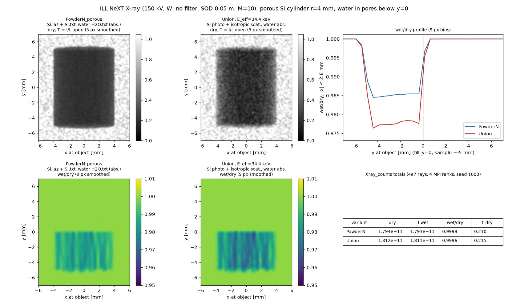

# ILL NeXT X-ray arm models

DRAFT McXtrace models of the X-ray cone-beam tomography arm of NeXT-Grenoble at
the ILL, operated together with, and perpendicular to, the neutron beam (McStas
`ILL_H521_NeXT`). The tube and flat panel are written once and `%include`d by
every model, so each model file holds only its sample.

## Models

| Folder / instrument | Sample | Purpose |
|---|---|---|
| [ILL_NeXT_Xray](ILL_NeXT_Xray/ILL_NeXT_Xray.instr) | Fe rod, optional inner cylinder or OFF shape; `sample=0` gives the flat field | Bimodal comparison with the neutron NeXT model; spectra behind the sample and in the open beam |
| [ILL_NeXT_Xray_porous](ILL_NeXT_Xray_porous/ILL_NeXT_Xray_porous.instr) | porous Si cylinder, water in the pores (PowderN_porous) | Imaging of water uptake in a porous material |
| [ILL_NeXT_Xray_porous_Union](ILL_NeXT_Xray_porous_Union/ILL_NeXT_Xray_porous_Union.instr) | same sample, Union components | Union reference for ILL_NeXT_Xray_porous, multiple scattering, one effective energy |

Building blocks:

| Folder / instrument | Content |
|---|---|
| [ILL_NeXT_Xray_source](ILL_NeXT_Xray_source/ILL_NeXT_Xray_source.instr) | Microfocus tube (Source_lab, W), Be window, optional pre-filter, sample axis at `SOD` (`sample_axis`, rotated `sample_rot`). Runs standalone for the tube spectrum |
| [ILL_NeXT_Xray_detector](ILL_NeXT_Xray_detector/ILL_NeXT_Xray_detector.instr) | Varex PaxScan 2530HE flat panel at `SDD`: photon counts and energy-weighted image |

## Building your own sample model

```
DEFINE INSTRUMENT My_NeXT_sample(...)
...
TRACE
%include "ILL/ILL_NeXT_Xray/ILL_NeXT_Xray_source/ILL_NeXT_Xray_source.instr"

COMPONENT Sample = ...
AT (0,0,0) RELATIVE sample_rot

%include "ILL/ILL_NeXT_Xray/ILL_NeXT_Xray_detector/ILL_NeXT_Xray_detector.instr"
END
```

All tube and detector parameters (`kV`, `tube_current`, `filter`, `SOD`, `SDD`,
`omega`, `det_binning`, ...) become parameters of the including instrument;
redeclaring one in your `DEFINE INSTRUMENT` overrides its default (as
the porous variants do for `SOD`). The include paths are relative to the
McXtrace `examples` folder, so they resolve from any working directory.

## Porous sample variants

Si cylinder (radius 4 mm, height 10 mm) with pore channels along y from
`pores.off` in the McXtrace data folder (the same mesh as the McStas PSI_ICON
porous models), made with `Tests_samples/Test_PowderN_porous/make_pores.py`:

```
python make_pores.py --radius 0.004 --yheight 0.01 --diameter 3e-4 --diameter_sigma 5e-5 --length 1.5e-3 --length_sigma 5e-4 --tilt 15 --seed 1
```

`water=1` fills the pores below `fill_y` (default 0, the sample centre), above
that they are void; `water=0` gives the dry reference. Both variants set
`SOD=0.05` m: M=10, 56 µm pixels at the object (`det_binning=4`).

| Variant | Si | Water |
|---|---|---|
| ILL_NeXT_Xray_porous | PowderN_porous: `Si.laz` Bragg lines, `Si.txt` attenuation vs energy | `H2O.txt`, 1 g/cm³, attenuation vs energy, no scattering |
| ILL_NeXT_Xray_porous_Union | `Si.txt` at `E_eff`: photoelectric as absorption, coherent + incoherent as isotropic `Incoherent_process` | `H2O.txt` at `E_eff`, absorption only |

McXtrace Union materials have a single constant absorption coefficient, so the
Union variant takes all coefficients at one effective energy. `E_eff=34.4` keV
reproduces the dry transmission of ILL_NeXT_Xray_porous at 150 kV without a
filter; for other tube settings, adjust it.

PowderN_porous is single scattering with forced transmission; Union is analog,
with multiple scattering.

### Comparison



All runs: `mxrun -y -n 4e7 --mpi=4 -s 1000`, default parameters, `water=0`
(dry) or `water=1` (wet); macOS arm64.

| Variant | I dry | I wet | T dry (centre) | wet/dry, wet half | wet/dry, dry half | t [s] |
|---|---|---|---|---|---|---|
| PowderN_porous | 1.794e11 ± 0.18e9 | 1.793e11 ± 0.18e9 | 0.210 | 0.9851 | 1.0000 | 11 |
| Union, `E_eff=34.4` keV | 1.812e11 ± 0.18e9 | 1.811e11 ± 0.18e9 | 0.215 | 0.9776 | 1.0000 | 20-24 |

`Xray_counts` totals; T dry = mean sample counts (|x| < 2.8 mm, |y| < 4.4 mm)
over an open-beam strip at the panel edge; wet/dry over the same 100 px wide
column below and above `fill_y`.

### Findings

- **The water shows only below `fill_y`, in both variants**: behind the wet
  half, PowderN_porous gives a 1.5 % drop, against dry; above it the ratio is
  1.0000.
- **Union overestimates the water contrast (2.2 % vs 1.5 %)**: the Si matrix
  hardens the beam, so behind the sample the photons are on average harder than
  `E_eff` and see a weaker water attenuation. One `E_eff` cannot fit both the Si
  and the water.
- **Union puts 1 % more counts on the panel**: probably the coherent part, scattered
  isotropically (no Bragg cones), of which the 250 x 300 mm panel catches
  much (not verified). The Union dry image is also noisier (analog transport, fewer
  photons per pixel).
- **Use PowderN_porous for polychromatic tube spectra**; the Union variant is a
  check of geometry and transport, and works for a narrow band (set `E_eff` to it).
- The pores are 0.3 mm channels; `det_binning=1` (14 µm at the object) resolves
  them better.

## Links

- https://www.ill.eu/en/for-ill-users/instruments/instruments-list/next/
- A. Tengattini et al., NIM A 968 (2020) 163939, doi:10.1016/j.nima.2020.163939
- McStas: `mcstas-comps/examples/ILL/ILL_H521_NeXT`, `mcstas-comps/examples/PSI/PSI_ICON`
